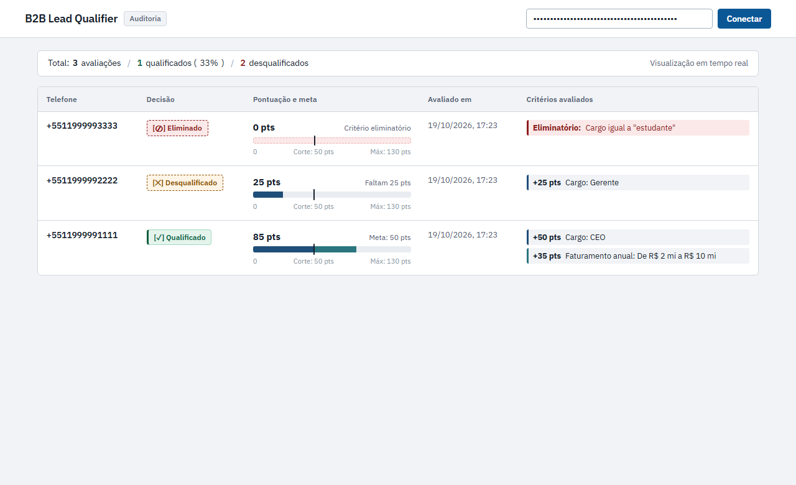
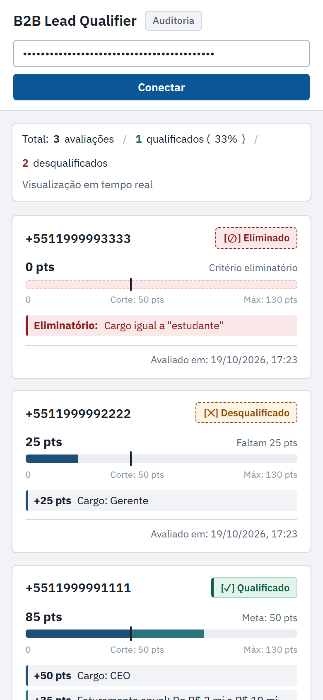
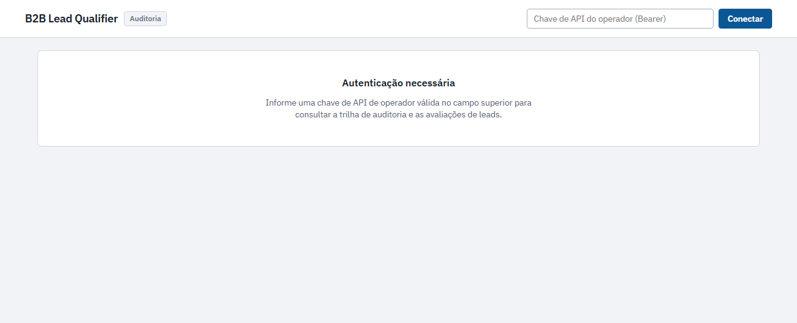
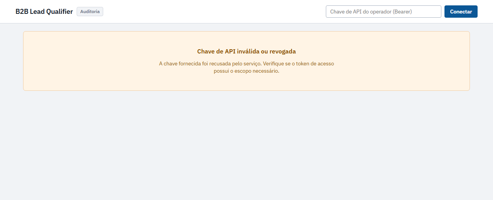
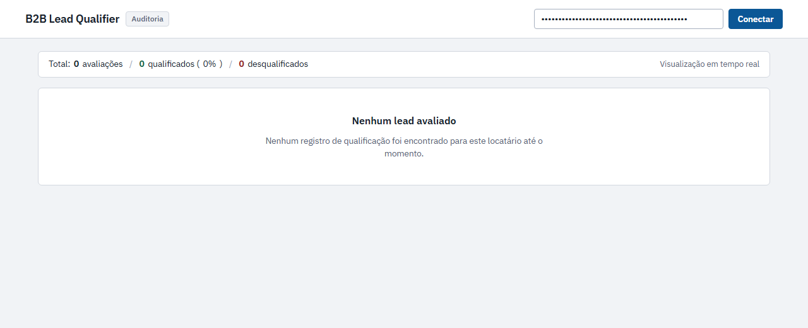

# Dashboard UI States & Visual Specification

This document details the visual states, accessibility considerations, and design choices of the B2B Lead Qualifier Audit Dashboard (`/dashboard`).

The interface follows a strict **audit ledger aesthetic** designed for commercial managers in office and mobile environments during daytime operations. It employs a clean light theme, the `IBM Plex Sans` typography with tabular numerals (`tabular-nums`), an integrated text summary bar, and explicit visual forms to differentiate decisions without relying solely on color.

---

## 1. Primary Inspection Views

### Desktop View (1280px)
Displays the integrated summary bar in text and the analytical audit table. Leads are scaled according to the theoretical maximum score (`max_possible_score`) defined by the tenant's active scoring rule set version.

### Mobile View (390px)
Transforms tabular rows into stacked audit ledger cards (`.lead-card`) without horizontal scrolling. The first evaluated lead is immediately visible within the initial mobile viewport fold.

---

## 2. Decision Breakdown & Score Scaling

The audit dashboard evaluates three distinct business outcomes:

| Phone Number | Verdict Badge | Score / Scale | Cutoff | Audit Reasons |
|---|---|---|---|---|
| `+5511999991111` | `[✓] Qualificado` | **85** / 130 pts | 50 pts | `+50 pts Cargo: CEO` `+35 pts Faturamento anual: De R$ 2 mi a R$ 10 mi` |
| `+5511999992222` | `[✕] Desqualificado` | **25** / 130 pts | 50 pts | `+25 pts Cargo: Gerente` *(Faltam 25 pts para a nota de corte)* |
| `+5511999993333` | `[⊘] Eliminado` | **0** / 130 pts | 50 pts | `Eliminatório: Cargo igual a "estudante"` *(Disqualificação imediata no 1º turno)* |

### Visual Form and Scale Mechanics:
- **Segmented Rule Track**: Each scoring rule with positive points generates an individual horizontal segment proportional to its points:
  - Role rules: `--seg-role` (`#1f4e78` - corporate navy)
  - Revenue rules: `--seg-rev` (`#2a757e` - corporate teal)
  - Company size rules: `--seg-size` (`#4a6572` - corporate slate)
- **Cutoff Marker**: A vertical marker (`--bar-threshold: #18202b`) is positioned at `(qualification_threshold / max_possible_score) * 100%`, providing an immediate visual reference.
- **Deficit Hint**: When a lead is not qualified by score, the interface explicitly informs the remaining deficit (e.g., *"Faltam 25 pts"*).
- **Knockout Highlight**: Leads disqualified by knockouts display a dashed warning track and a distinct alert container identifying the restricted criterion.
- **Form-Based Decision Badges**:
  - Qualified: `[✓] Qualificado` with a solid 3px left border.
  - Not Qualified: `[✕] Desqualificado` with a dashed border.
  - Disqualified (Knockout): `[⊘] Eliminado` with a dashed alert border.

---

## 3. Operational & Error States

### State 1: Authentication Required
Displayed upon initial visit when no Operator Bearer token has been configured.

### State 2: Invalid or Revoked API Key (HTTP 401)
Displayed when the API rejects the provided token. Error notices do not expose technical hosts, ports, or stack traces.

### State 3: Empty State (Zero Evaluated Leads)
Displayed when an authenticated tenant has no qualification records in `scoring_results`.

---

## 4. Security & Accessibility Architecture

1. **Anti-XSS Defense**: The template strictly avoids `innerHTML` across all rendering routines. DOM construction is performed exclusively via `document.createElement`, `textContent`, and typed property bindings.
2. **Accessible Attributes**: The score track includes descriptive `aria-label` tags detailing achieved score, maximum scale, and cutoff thresholds without invalid ARIA role violations.
3. **Number Legibility**: Numeric values and phone numbers utilize `font-feature-settings: "tnum" 1` and `font-variant-numeric: tabular-nums` to ensure strict vertical alignment.
4. **Structured Translations**: Audit text is rendered client-side using canonical Portuguese dictionary maps for fields (`role`, `revenue_tier`, `company_size`) and enum values without resorting to regex scraping. Unknown values fall back gracefully to their original representations.
5. **No Uppercase Transformations**: All badges, table headings, and labels strictly follow Sentence case throughout HTML markup and CSS.
